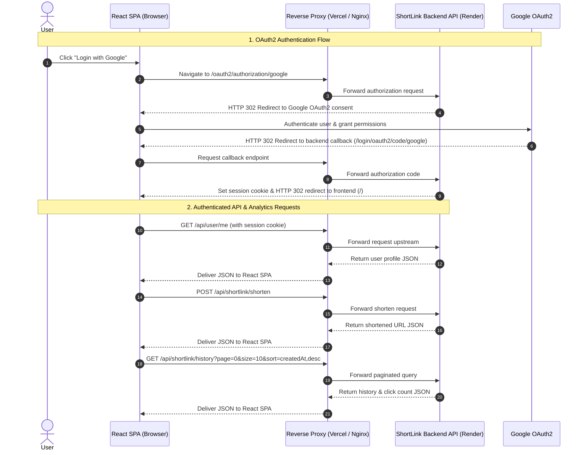

# ShortLink Frontend

ShortLink Frontend is a single-page web application for shortening URLs, tracking click analytics, and managing personal link histories. Built with React 19, Vite, and Tailwind CSS, the application communicates with a backend REST API and supports Google OAuth2 authentication.

---

## Backend API Service

- **Target API**: [https://shortlink-backend-9umi.onrender.com](https://shortlink-backend-9umi.onrender.com) (configured as the upstream proxy target in `vercel.json`)
- *Note: A verified public URL for the frontend application is not defined in the repository.*

---

## Features

- **URL Shortening**: Validates input URLs using the standard Web API `URL` constructor and requests shortened links via the backend API.
- **Google OAuth2 Authentication**: Redirects unauthenticated users to Google OAuth sign-in (`/oauth2/authorization/google`) and fetches session information (`/api/user/me`).
- **Link History Management**: Authenticated users can view their previously shortened URLs, original destinations, and creation timestamps.
- **Click Tracking & Metrics**: Displays click counts for each shortened URL in the link history table.
- **Server-Side Pagination and Sorting**: Powered by TanStack Table v8, sending page index, page size, and sort criteria directly to the backend pagination endpoint.
- **Dark and Light Theme**: Custom theme context supporting automatic system theme detection (`prefers-color-scheme`), local storage persistence, and manual switching.
- **Responsive Layout**: Designed for mobile and desktop viewports using Tailwind CSS utility classes and scoped CSS modules.
- **Donation Modal**: Provides an in-app QR code display for project support.

---

## Tech Stack

### Core Framework & Build Tools
- **Framework**: [React](https://react.dev/) 19.2.4
- **DOM Renderer**: React DOM 19.2.4
- **Build Tool**: [Vite](https://vite.dev/) 8.0.0
- **Vite React Plugin**: `@vitejs/plugin-react` 6.0.0

### UI & Styling
- **CSS Framework**: [Tailwind CSS](https://tailwindcss.com/) 3.4.19
- **CSS Post-processing**: PostCSS 8.5.8, Autoprefixer 10.4.27
- **Icon Library**: [React Icons](https://react-icons.github.io/react-icons/) 5.6.0

### Data & State Management
- **Table & Pagination**: [TanStack Table](https://tanstack.com/table) (`@tanstack/react-table`) 8.21.3
- **HTTP Client**: [Axios](https://axios-http.com/) 1.13.6

### Quality & Linting
- **Linter**: ESLint 9.39.4
- **Plugins**: `eslint-plugin-react-hooks` 7.0.1, `eslint-plugin-react-refresh` 0.5.2

### Deployment & Infrastructure
- **Containerization**: Docker (multi-stage build with `nginx:stable-alpine`)
- **Container Orchestration**: Docker Compose
- **Hosting / Proxy**: Vercel rewrite configuration
- **CI/CD**: GitHub Actions workflow (Docker Hub push and SSH server deployment)

---

## Architecture Overview

The frontend communicates with the backend API and external authentication providers via a configured reverse proxy (Vercel rewrites in production hosting or Nginx in containerized deployments):



---

## Project Structure

```text
shortlink-frontend/
├── .github/
│   └── workflows/
│       └── deploy.yaml         # GitHub Actions CI/CD deployment pipeline
├── public/                     # Static public assets (favicons, SVG icons)
├── src/
│   ├── assets/                 # Image assets (logos, background, donation QR)
│   ├── components/             # Reusable React components
│   │   ├── footer/             # Page footer component and styles
│   │   ├── history-table/      # Server-paginated link history table
│   │   ├── instruction/        # Step-by-step usage guide component
│   │   ├── login-modal/        # Google OAuth login prompt modal
│   │   ├── support-us/         # Support and donation QR code popover
│   │   ├── theme-toggle/       # Theme switch toggle button
│   │   └── topnav/             # Header navigation bar and user menu
│   ├── context/
│   │   └── ThemeContext.jsx    # Theme provider and theme toggle state
│   ├── infrastructure/
│   │   └── axiosClient.js      # Configured Axios instance with credentials support
│   ├── services/
│   │   └── shortlink.js        # API service methods (shorten, history, user, auth)
│   ├── App.css                 # Main application styling
│   ├── App.jsx                 # Application root view component
│   ├── index.css               # Base Tailwind CSS imports and global styles
│   └── main.jsx                # React DOM entry point
├── docker-compose.yaml         # Docker Compose service definition
├── Dockerfile                  # Multi-stage production Docker build
├── eslint.config.js            # ESLint flat configuration
├── index.html                  # HTML template with initial theme bootstrapping
├── package.json                # Project dependencies and script declarations
├── postcss.config.js           # PostCSS plugin configuration
├── tailwind.config.js          # Tailwind CSS design system configuration
├── vercel.json                 # Vercel routing rules and backend proxy rewrites
└── vite.config.js              # Vite bundler configuration
```

---

## Getting Started

### Prerequisites

- [Node.js](https://nodejs.org/) version 20 or higher
- [npm](https://www.npmjs.com/) (bundled with Node.js) or a compatible package manager

### Installation

1. Clone the repository:
   ```bash
   git clone https://github.com/hailong2002/shortlink-frontend.git
   cd shortlink-frontend
   ```

2. Install project dependencies:
   ```bash
   npm install
   ```

### Environment Configuration

The Axios client (`src/infrastructure/axiosClient.js`) configures its base URL using the `VITE_API_URL` environment variable:

| Variable | Required | Default | Description |
|---|---|---|---|
| `VITE_API_URL` | Optional | `""` (empty string) | Base URL for backend API requests. When omitted or empty, Axios issues relative paths (e.g., `/api/...`), which are routed through the configured reverse proxy (Vercel rewrites or Nginx). |

For local development against a standalone backend server (without a reverse proxy), create a `.env` or `.env.local` file in the project root:

```env
VITE_API_URL=http://localhost:8080
```

When deploying behind a reverse proxy (such as Vercel or Nginx), leave `VITE_API_URL` unset so requests default to relative paths and preserve session cookies.

### Running Locally

Start the Vite development server with Hot Module Replacement (HMR):

```bash
npm run dev
```

By default, the development server is available at `http://localhost:5173`.

---

## Available Scripts

| Command | Action |
|---|---|
| `npm run dev` | Starts the Vite local development server. |
| `npm run build` | Compiles source files and bundles static assets into `dist/`. |
| `npm run preview` | Serves the production build locally for verification. |
| `npm run lint` | Runs ESLint across the project to identify code quality issues. |

---

## Docker Deployment

The application includes a multi-stage `Dockerfile`:
1. **Build Stage (`node:20-alpine`)**: Copies dependency manifests, installs packages with `npm install`, and generates static assets using `npm run build`.
2. **Production Stage (`nginx:stable-alpine`)**: Copies the static distribution files from `/app/dist` to `/usr/share/nginx/html` and serves them via Nginx on port 80.

### Standalone Docker Container

Build and run the container locally using the multi-stage `Dockerfile`:

```bash
# Build the Docker image
docker build -t shortlink-fe .

# Run the container mapping host port 8080 to container port 80
docker run -d -p 8080:80 --name shortlink-app-fe shortlink-fe
```

Access the application in your browser at `http://localhost:8080`.

### Docker Compose

The repository includes a `docker-compose.yaml` configuration intended for production deployment within an existing server environment:

- **Image**: `${DOCKER_HUB_USERNAME}/shortlink-fe:latest` (requires the `DOCKER_HUB_USERNAME` environment variable)
- **Container Name**: `shortlink-app-fe`
- **Restart Policy**: `on-failure`
- **Network**: Connects to an external Docker network named `nginx-network` (`external: true`)
- **Volume Mount**: Mounts `./nginx-fe.conf` to `/etc/nginx/conf.d/default.conf`
- **Port Mapping**: Ports are commented out in `docker-compose.yaml` (`# - 3000:3000`) because routing is managed by the external reverse proxy on `nginx-network`.

> [!IMPORTANT]
> The referenced Nginx configuration file `nginx-fe.conf` is not tracked in the git repository. Before starting the container with `docker compose up -d`, you must provide a valid `nginx-fe.conf` file in the working directory and ensure the external network exists (`docker network create nginx-network`).

---

## Deployment Configuration

### Vercel Reverse Proxy (`vercel.json`)

When hosted on Vercel, requests are proxied according to rules defined in `vercel.json`:

- `/api/:path*` &rarr; `https://shortlink-backend-9umi.onrender.com/api/:path*`
- `/oauth2/:path*` &rarr; `https://shortlink-backend-9umi.onrender.com/oauth2/:path*`
- `/login/oauth2/:path*` &rarr; `https://shortlink-backend-9umi.onrender.com/login/oauth2/:path*`
- `/(.*)` &rarr; `/index.html` (Single-Page Application fallback)

This routing setup avoids Cross-Origin Resource Sharing (CORS) complications and cookie isolation problems during OAuth authentication.

### CI/CD Workflow (`.github/workflows/deploy.yaml`)

Automated deployment is configured using GitHub Actions on commits to the `main` branch:
1. Builds the project with Node.js 20.
2. Authenticates to Docker Hub using repository secrets.
3. Builds and pushes the image to Docker Hub under the tag `${{ secrets.DOCKER_HUB_USERNAME }}/shortlink-fe:latest`.
4. Connects to the deployment server via SSH, pulls the updated image, and restarts services via `docker compose`.
